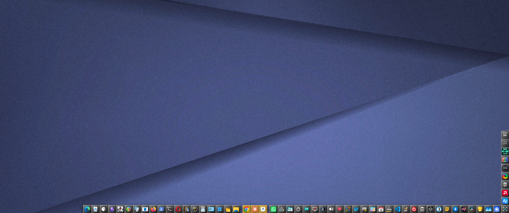
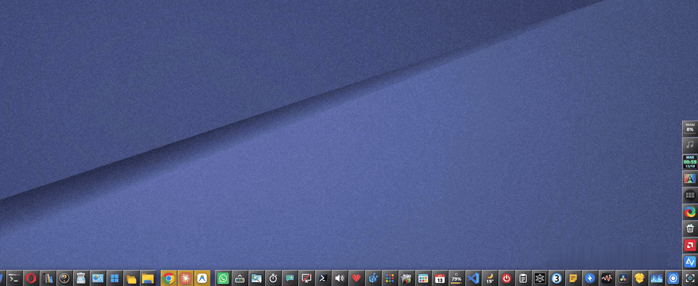
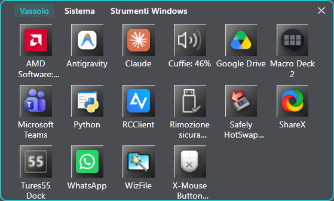
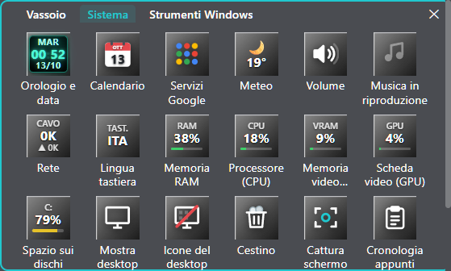
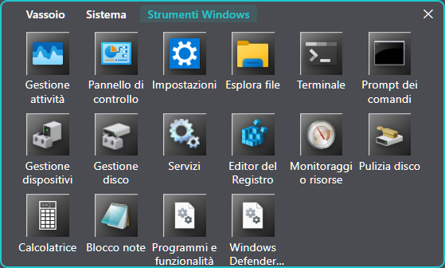
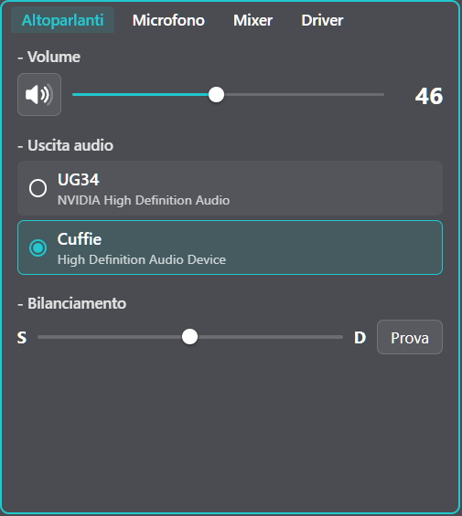
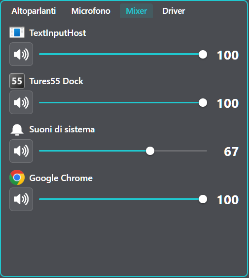
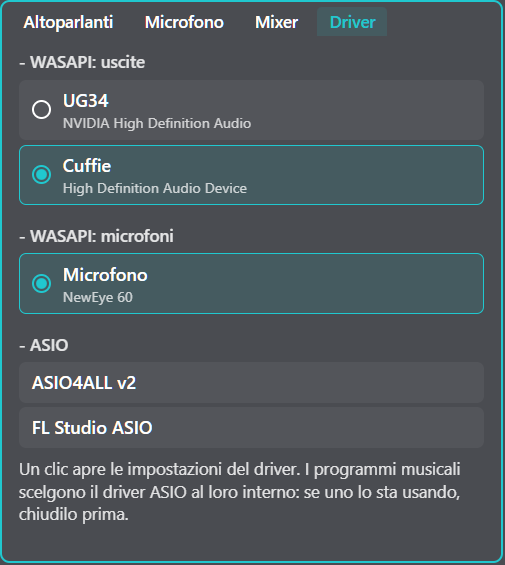
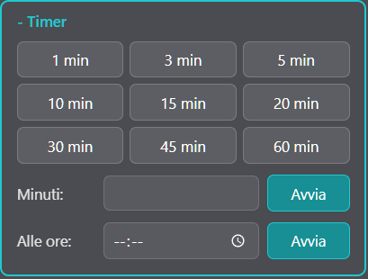
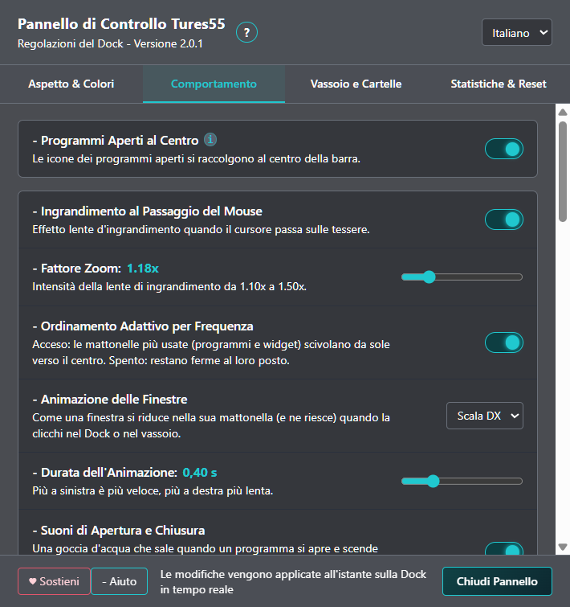

# Tures 55 Dock — Windows taskbar replacement & macOS-style dock

**Alternativa gratuita alla barra delle applicazioni di Windows 11: una dock in stile macOS, come Winstep Nexus, RocketDock e ObjectDock.**
**Free Windows 11 taskbar replacement: a macOS-style dock, an alternative to Winstep Nexus, RocketDock and ObjectDock.**

| Vassoio / System tray | Widget | Strumenti Windows / Windows tools |
|---|---|---|
|  |  |  |

| Volume | Mixer | Driver (WASAPI / ASIO) |
|---|---|---|
|  |  |  |

| Servizi Google | Timer | Pannello di controllo / Control Panel |
|---|---|---|
|  |  |  |

## ⬇️ Scarica / Download

### **[⬇️ Scarica Tures 55 Dock per Windows / Download for Windows](https://github.com/Tures55/tures55-dock/releases/latest/download/Tures55-Dock-Setup.exe)**

Il clic scarica subito `Tures55-Dock-Setup.exe`, sempre l'ultima versione: aprilo e segui i passi. La barra installata poi si aggiorna da sola.
One click downloads `Tures55-Dock-Setup.exe`, always the latest version: open it and follow the steps. The installed dock then updates itself.

Tutte le versioni / All versions: [Releases](https://github.com/Tures55/tures55-dock/releases)

---

## 🇮🇹 Italiano

Tures 55 Dock sostituisce la barra delle applicazioni di Windows con una dock moderna, pensata per essere semplice e leggibile.

- **Programmi più usati al centro**: le icone si ordinano da sole secondo l'uso (si può spegnere).
- **Programmi aperti al centro**, che tornano al loro posto quando li chiudi.
- **Widget**: orologio, calendario, meteo, volume, musica, rete, RAM, CPU, GPU, dischi, note al volo, timer e altri.
- **Vassoio** (icone di sistema) e **Cartelle** in finestre comode.
- **Pannello del volume completo**: altoparlanti, microfono, mixer per programma, driver ASIO.
- Colori, trasparenza e dimensioni regolabili dal Pannello di controllo.
- Interfaccia in italiano e inglese.

### Licenza
Gratuita per uso personale. Puoi condividere l'installatore originale, gratis e senza modificarlo, indicando questa pagina ufficiale: https://github.com/Tures55/tures55-dock

Se ti è utile puoi sostenerlo: https://buymeacoffee.com/tures1955

---

## 🇬🇧 English

Tures 55 Dock replaces the Windows taskbar with a modern, easy-to-read dock.

- **Most used apps in the middle**: icons sort themselves by usage (can be turned off).
- **Open apps in the center**, going back to their place when closed.
- **Widgets**: clock, calendar, weather, volume, now playing, network, RAM, CPU, GPU, disks, quick notes, timer and more.
- **System tray** and **Folders** in handy windows.
- **Full volume panel**: speakers, microphone, per-app mixer, ASIO drivers.
- Colors, transparency and size adjustable from the Control Panel.
- Italian and English interface.

### License
Free for personal use. You may share the original installer, free of charge and unmodified, linking to this official page: https://github.com/Tures55/tures55-dock

If you find it useful you can support it: https://buymeacoffee.com/tures1955